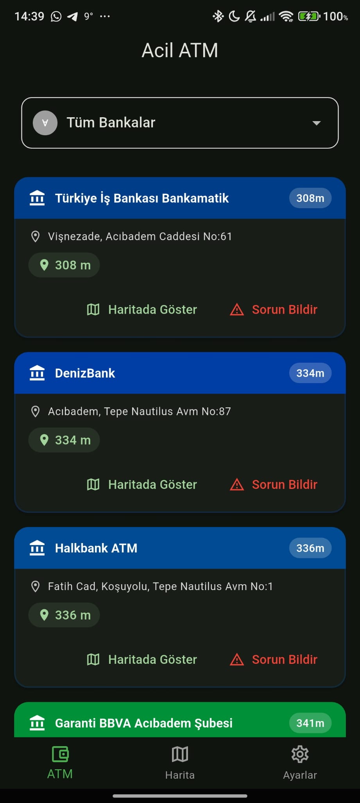
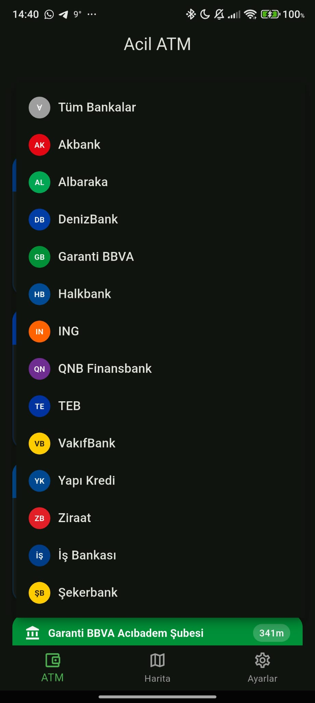
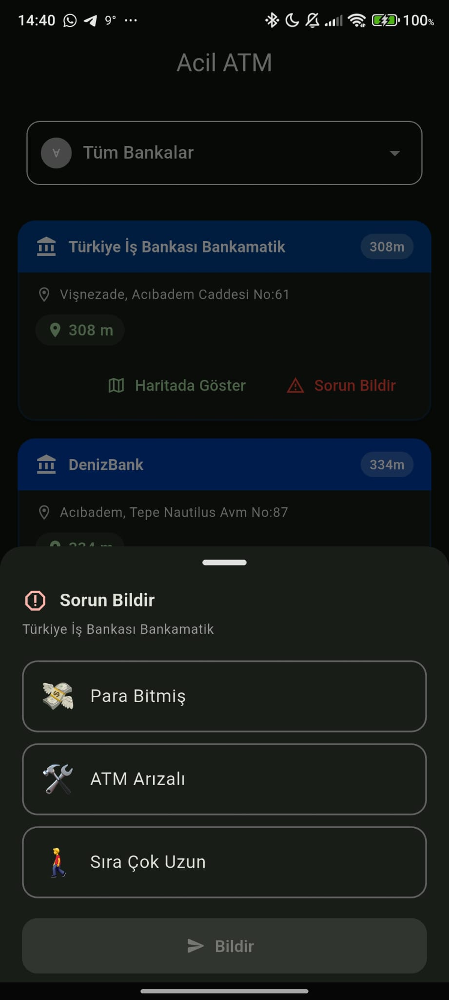

# ACİL ATM

Yakınınızdaki ATM'leri harita üzerinde bulan ve kullanıcıların ATM sorunlarını (para yok, arızalı, uzun kuyruk vb.) anlık olarak paylaşabildiği kitle kaynaklı bir Flutter mobil uygulaması.

## Özellikler

- Konuma göre yakındaki ATM'leri Google Maps üzerinde görüntüleme (Google Places API)
- Banka bazlı filtreleme ve banka renk temaları
- Kitle kaynaklı sorun bildirimi: *para yok, arızalı, uzun kuyruk, kart okuyucu bozuk, ekran bozuk*
- Bildirimlerin Firestore üzerinden gerçek zamanlı dinlenmesi (bildirimler 3 saat sonra geçersiz sayılır)
- Firestore tabanlı ATM önbelleği (koordinat gridine göre, 14 gün TTL) ile Google API çağrılarının azaltılması
- Karanlık/aydınlık tema desteği

## Ekran Görüntüleri

<table>
  <tr>
    <td align="center"><br/><sub>Yakındaki ATM'ler</sub></td>
    <td align="center"><br/><sub>Banka filtresi</sub></td>
    <td align="center"><br/><sub>Sorun bildirme</sub></td>
  </tr>
</table>


## Teknolojiler

Flutter · Dart · Google Maps / Places API · Firebase (Core, Cloud Firestore, Analytics) · Geolocator · Envied

## Kurulum

Gizli anahtarlar bu repoda **bulunmaz**. Çalıştırmak için kendi anahtarlarınızı eklemeniz gerekir.

### 1. Depoyu klonlayın

```bash
git clone <repo-url>
cd acil_atm
flutter pub get
```

### 2. Google Maps / Places API anahtarı

[Google Cloud Console](https://console.cloud.google.com/) üzerinden bir proje oluşturup **Maps SDK for Android** ve **Places API** servislerini etkinleştirin, bir API anahtarı üretin. Anahtarı Android paket adı ve SHA-1 ile kısıtlamanız önerilir.

**a) Dart tarafı (Places isteği):**

```bash
cp assets/api.env.example assets/api.env
# assets/api.env içindeki YOUR_GOOGLE_MAPS_API_KEY değerini kendi anahtarınızla değiştirin
dart run build_runner build --delete-conflicting-outputs
```

Bu komut `lib/env/env.g.dart` dosyasını üretir (git'e dahil değildir).

**b) Android tarafı (harita SDK'sı):** `android/local.properties` dosyasına şu satırı ekleyin:

```properties
MAPS_API_KEY=YOUR_GOOGLE_MAPS_API_KEY
```

### 3. Firebase

1. [Firebase Console](https://console.firebase.google.com/) üzerinde bir proje oluşturun ve **Cloud Firestore** veritabanını başlatın.
2. Android uygulamasını `com.example.acil_atm` paket adıyla ekleyin (farklı paket adı kullanırsanız `android/app/build.gradle.kts` içindeki `applicationId` ve `namespace` değerlerini de güncelleyin).
3. İndirdiğiniz `google-services.json` dosyasını `android/app/` altına koyun. Şablon için `android/app/google-services.json.example` dosyasına bakın.
4. Kullanılan Firestore koleksiyonları: `atm_reports` (sorun bildirimleri) ve `cached_atms` (önbellek).

> [!WARNING]
> Firestore güvenlik kurallarınızı (Security Rules) herkese açık yazmaya izin vermeyecek şekilde yapılandırın.

### 4. Çalıştırma

```bash
flutter run
```

## Git'e dahil edilmeyen dosyalar

| Dosya | Açıklama |
|---|---|
| `assets/api.env` | Google Maps API anahtarı (şablon: `api.env.example`) |
| `lib/env/env.g.dart` | `build_runner` ile üretilir |
| `android/app/google-services.json` | Firebase yapılandırması (şablon: `.example`) |
| `android/local.properties` | Yerel SDK yolları ve `MAPS_API_KEY` |

## Lisans / Not

Bu proje eğitim ve portföy amaçlıdır. ATM bilgileri Google Places verisine ve kullanıcı bildirimlerine dayanır; doğruluğu garanti edilmez.
